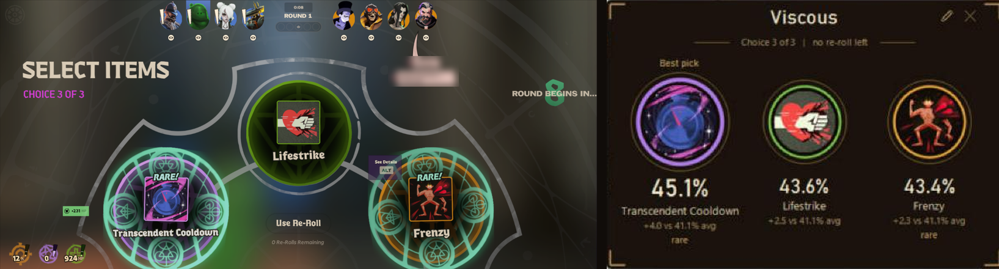
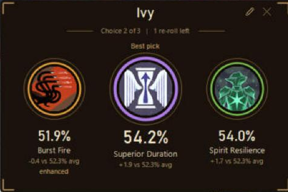

# Deadlock Street Brawl item overlay

A small always-on-top window that reads the Street Brawl item offer from your screen, detects your hero, and ranks the offered items using public Street Brawl match stats from api.deadlock-api.com. Street Brawl only.

Nothing to install: it uses Windows PowerShell and Windows' built-in text recognition.

## Download and start
Requirements: Windows 10 (version 2004 or newer) or Windows 11, and Deadlock in borderless windowed mode (the overlay cannot draw over exclusive fullscreen).

1. Click the green **Code** button on this page, then **Download ZIP**, and extract it to any folder (for example `Documents\DeadlockItemOverlay`).
2. Double-click `collect.bat` once (a few minutes the first time). It downloads the Street Brawl stats, item names, hero ability icons and item icons into a `data` folder next to the scripts.
3. Double-click `overlay.bat`. Deadlock can already be running. Use `overlay-debug.bat` instead to see any errors in a console.
4. Optional: double-click `setup-daily-refresh.bat` to refresh the stats once a day automatically.

If Windows shows a "Windows protected your PC" prompt for a `.bat` file, click **More info**, then **Run anyway**. Everything runs on built-in Windows PowerShell; nothing is installed.

## Overlay window
- The header shows your hero (detected from the 4 ability icons at the bottom of the HUD) and one status line: choice number, re-rolls left and how often you took the top pick this match during the shop, your hero's average win rate otherwise.
- Under each medallion: expected win %, the name, points vs your hero's Street Brawl average win rate (shown, for example "+2.9 vs 52.3% avg"), brass marks for enhanced (with its boost), rare and few games, in-game tooltip values when you hover the item in the shop, and your own note from `notes.json`.
- Screen reading is always on while Deadlock is the active window. It reads every 1.5 s: item names (including tilted rare names), ENHANCED and RARE tags, choice and re-rolls, the hovered tooltip, and the "Item purchased" panel.
- **Hides itself outside the item phase** (a few seconds after the shop closes) and comes back when it opens, without taking focus from the game. **Ctrl+Alt+S** keeps it always visible (press again to undo). It always shows when Deadlock is not the active window.
- **Edit button** (pencil, top right): hero list, the 3 item boxes, **Best by tier** (2 best items per tier) and **Clear**, for checking items by hand.
- Drag the header to move the window; its position is remembered. **Ctrl+Alt+D** turns click-through on and off. Esc or X closes it.
- **Pick history**: every offer is logged to `data\pick_history.csv` (opens in Excel): round, choice, hero, offered items in rank order with expected win %, the top pick, what you picked, its rank, and whether you took the top pick. Re-rolled offers are marked "rerolled".
- The window hides itself from screen capture, so the reader never reads its own text. Screenshots and recordings will not show it (`overlay-preview.bat` opens a visible copy with reading off).
- Data reloads automatically within a minute after the daily refresh. Readings are logged to `data\screen_debug.txt`; the last shop screen is saved as `data\last_shop.png`.

## Pick summary
Double-click `summary.bat`. It opens a page (`data\summary.html`) with how often you took the overlay's top pick, the average rank of your picks, your win rate when you mostly took the top pick versus otherwise, a by-hero table and every logged match with its offers. What you bought and whether you won come from your public match history on deadlock-api.com (your Steam account is found automatically); matches the site has not picked up yet show as pending, using the picks the overlay read on screen.

## Command line check
Open a Command Prompt in this folder:
```
rank.bat Ivy "Tesla Bullets" "Toxic Bullets" "Burst Fire"
rank.bat Ivy tesla toxic burst
rank.bat -Top Paige        (best 2 per tier)
```
Short or slightly misspelled names work.

## Daily refresh
A Windows scheduled task named "Deadlock Item Overlay refresh" runs `collect.ps1` daily at 11:40 AM while you are logged in; if the PC was asleep then, it runs as soon as it can. `setup-daily-refresh.bat` creates or resets it (result in `data\scheduled_task.txt`). Remove it with `schtasks /Delete /TN "Deadlock Item Overlay refresh" /F`.

Each run saves `data\<date>\snapshot.json`, updates `data\latest.json`, and writes `data\latest_changes.txt` (new, renamed, removed or re-priced items, new heroes, a new big patch, and any item IDs with no name). Log: `data\collect.log`. Snapshots older than 30 days are deleted.

## How the ranking works
- **Sort order = expected win %**: your hero's Street Brawl win rate in games where the item was picked. Small samples are pulled toward the hero's average (as if each item had 1,000 extra average games), so a lucky 300-game item cannot top the list. "vs avg" is the same number minus the hero's average.
- **ENHANCED**: by default an Enhanced item shows the regular item's win rate, with an "enhanced" mark. Turn on **Enhanced boost** (pencil button, or **Ctrl+Alt+E**) to add a measured boost instead: Street Brawl match data marks Enhanced copies, so the overlay measures per item how much more Enhanced copies win than regular ones (all heroes), pulled toward the typical boost for that tier (about +1.3 to +2 pts for tiers 1 to 4, about 0 for tier 5) and never below 0.
- **Per hero**: the Enhanced boost uses your hero's own Enhanced vs regular results (last 7 days of Street Brawl) when there are enough games, pulled toward the all-heroes boost when there are few.
- **RARE**: a rare offer is one tier above the others; it is ranked by its own win rate like any item.
- **GOOD FIT**: the game files tag each item "Good" or "Normal" per hero for the Street Brawl item draft. Shown for information; it does not change the score.
- **buy rate**: how often the hero ends a game with the item. This is NOT pick rate when offered; the API does not record which items were offered.
- **n**: matches with the item. Under 1,000 is flagged as thin.
- Data window: since the last big patch, at most 30 days back. Enhanced data comes from the public data lake (falls back to the last 3 days, or the previous refresh, if the long window fails).
- `notes.json`: your own one-line notes per hero and item, shown after the stats.

## Limits
- Win rate with an item is not proof the item caused the win; it is the best public signal.
- The overlay only reads public stats and your screen. No game memory reading, no injection, no input to the game.
- Not affiliated with or endorsed by Valve. Deadlock and its item art belong to Valve; stats come from the community-run [deadlock-api.com](https://deadlock-api.com).

## License
MIT. See `LICENSE`.

## Screenshots


A real Street Brawl shop with two rare items, and the overlay ranking that same offer for Viscous.



An Ivy offer: Burst Fire is enhanced. With the Enhanced boost off it shows the regular item's win rate and an "enhanced" mark.
